# Kafka Architecture — General Overview

A single diagram of how Apache Kafka works in general. This is not specific to this app; for how
this backend uses Kafka (via Redpanda), see [07-events-and-activity-feed.md](07-events-and-activity-feed.md).

**Legend:** thin solid arrows = data flow · thick arrows = replication · dashed arrows =
control/metadata (schemas, offsets, leader election) · gold nodes = partition leaders (all reads
and writes for a partition go through its leader).

```mermaid
flowchart TB
  subgraph PROD["① PRODUCERS — write side · serialize → choose partition: hash(key) % N, or sticky if no key → batch → send (acks=all, idempotent)"]
    direction LR
    PA["Producer app A<br/>key = cust-42"]
    PB["Producer app B<br/>no key"]
    SRC["Kafka Connect SOURCE<br/>DB CDC · files · APIs"]
  end

  SR[("Schema Registry<br/>Avro / Protobuf / JSON<br/>each message carries a schema ID")]

  subgraph CLUSTER["② KAFKA CLUSTER — topic 'orders' · 3 partitions · replication factor 3"]
    direction TB
    subgraph CTRL["Control plane · KRaft controller quorum (Raft) — ZooKeeper in older clusters"]
      direction LR
      K1["Controller 1 ★ active"] --- K2["Controller 2"] --- K3["Controller 3"]
    end
    subgraph BROKERS[" "]
      direction LR
      subgraph B1["Broker 1"]
        direction TB
        B1P0["P0 ★ LEADER"]
        B1P1["P1 follower"]
        B1P2["P2 follower"]
      end
      subgraph B2["Broker 2"]
        direction TB
        B2P1["P1 ★ LEADER"]
        B2P0["P0 follower"]
        B2P2["P2 follower"]
      end
      subgraph B3["Broker 3"]
        direction TB
        B3P2["P2 ★ LEADER"]
        B3P0["P0 follower"]
        B3P1["P1 follower"]
        OFF[("__consumer_offsets<br/>+ group coordinator")]
      end
    end
  end

  subgraph LOG["③ ANATOMY OF ONE PARTITION — append-only ordered log"]
    direction LR
    S1["segment<br/>offsets 0–999"] --> S2["segment<br/>1000–1999"] --> S3["active segment<br/>2000–2047 ← appends"]
    S3 --> HW["high watermark<br/>= replicated to all ISR<br/>consumers read up to here"]
    RET["retention: delete by time/size<br/>or compact (latest per key)"]
  end

  subgraph CONS["④ CONSUMERS — read side · pull via poll() · track their own offsets"]
    direction LR
    subgraph G1["group 'billing' — partitions SPLIT across members"]
      C1["consumer 1 ← P0, P1"]
      C2["consumer 2 ← P2"]
    end
    subgraph G2["group 'analytics' — gets its OWN full copy"]
      C3["consumer 1 ← P0, P1, P2"]
    end
    STR["Kafka Streams app<br/>consume → transform → produce"]
    SNK["Kafka Connect SINK<br/>warehouse · search · S3"]
  end

  PA -->|"produce"| B1P0
  PB -->|"produce"| B2P1
  SRC -->|"produce"| B3P2

  B1P0 ==>|"followers fetch (ISR)"| B2P0
  B1P0 ==> B3P0
  B2P1 ==> B1P1
  B2P1 ==> B3P1
  B3P2 ==> B1P2
  B3P2 ==> B2P2

  B1P0 --> C1
  B2P1 --> C1
  B3P2 --> C2
  B1P0 --> C3
  B2P1 --> C3
  B3P2 --> C3
  B3P2 --> STR
  B1P0 --> SNK

  K1 -.->|"metadata · leader election · failover"| BROKERS
  PA -.->|"register schema"| SR
  SR -.->|"lookup by ID"| C3
  G1 -.->|"commit offsets"| OFF
  BROKERS -.-|"every partition replica is one of these logs"| LOG

  classDef leader fill:#ffe08a,stroke:#b8860b,stroke-width:2px,color:#000
  classDef follower fill:#eef3ff,stroke:#7a8fbf,color:#333
  classDef ctrl fill:#e8d9ff,stroke:#7b52c9,color:#000
  classDef ext fill:#d9f5e3,stroke:#2e8b57,color:#000
  classDef store fill:#f2f2f2,stroke:#555,color:#000
  class B1P0,B2P1,B3P2 leader
  class B1P1,B1P2,B2P0,B2P2,B3P0,B3P1 follower
  class K1,K2,K3 ctrl
  class SRC,SNK,STR,SR ext
  class OFF,S1,S2,S3,HW,RET store
```

## Key ideas

- **Partitions are where the scaling and the ordering come from.** A topic is just a name; the
  real unit is the partition, an append-only log stored on disk. Kafka keeps order only within
  one partition, so every event with the same key (`cust-42` → P0) stays in order.
- **Consumer groups give you both a queue and pub/sub.** Inside one group, each partition goes to
  exactly one member, so the members share the work like a queue. Separate groups each get the
  full stream, like pub/sub. A group can have at most as many active consumers as there are
  partitions; any extra consumers sit idle.
- **Kafka doesn't track what consumers have read.** Consumers pull data and commit their own
  offsets to `__consumer_offsets`. Messages stay until retention removes them, whether or not
  anyone has read them, which is what makes replay possible.
- **`acks=all` plus the high watermark make reads durable.** A consumer only sees records already
  copied to every in-sync replica (ISR), so a leader failover can't remove a record a consumer
  has already read.
- **The controller quorum manages the cluster but never carries messages.** It records which
  broker leads each partition and the ISR membership, and elects a new leader when a broker
  fails. Since Kafka 4.0 this is KRaft (Raft-based); older clusters used ZooKeeper.
